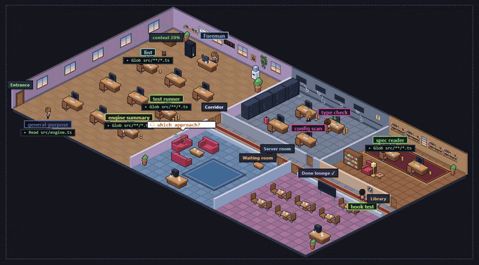
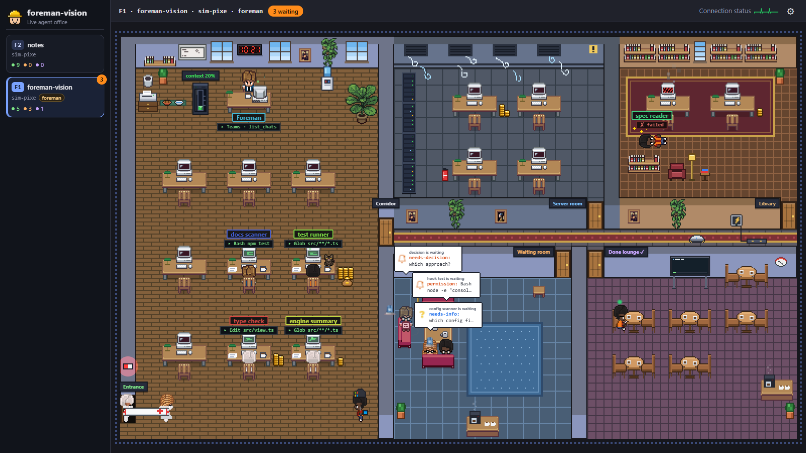
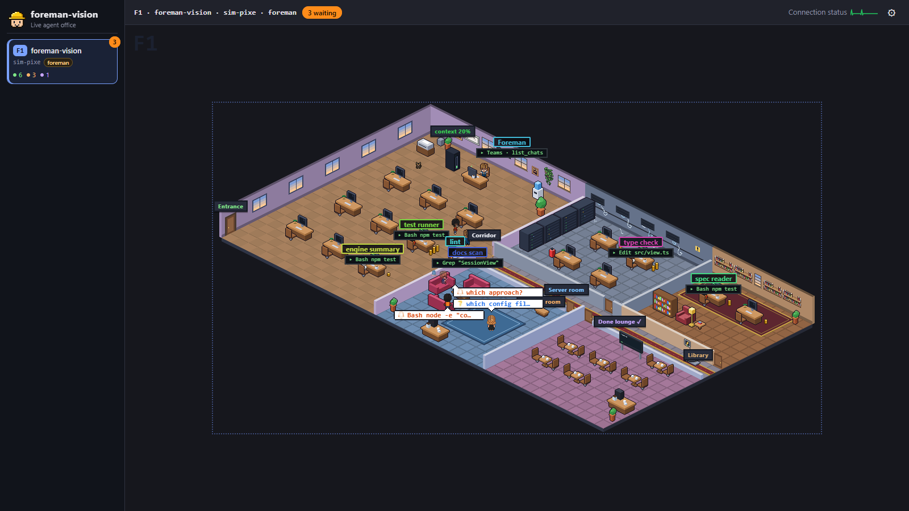
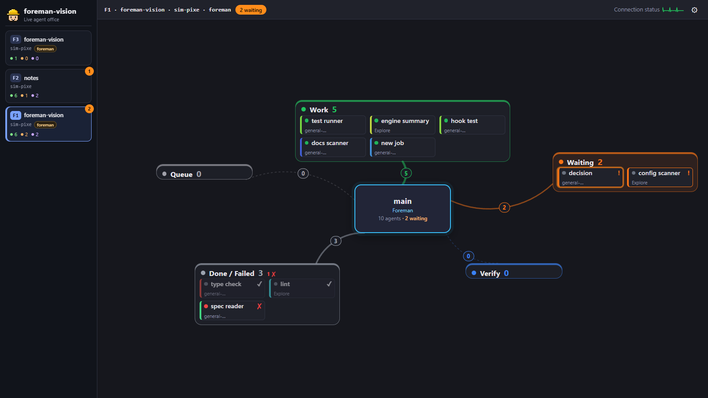
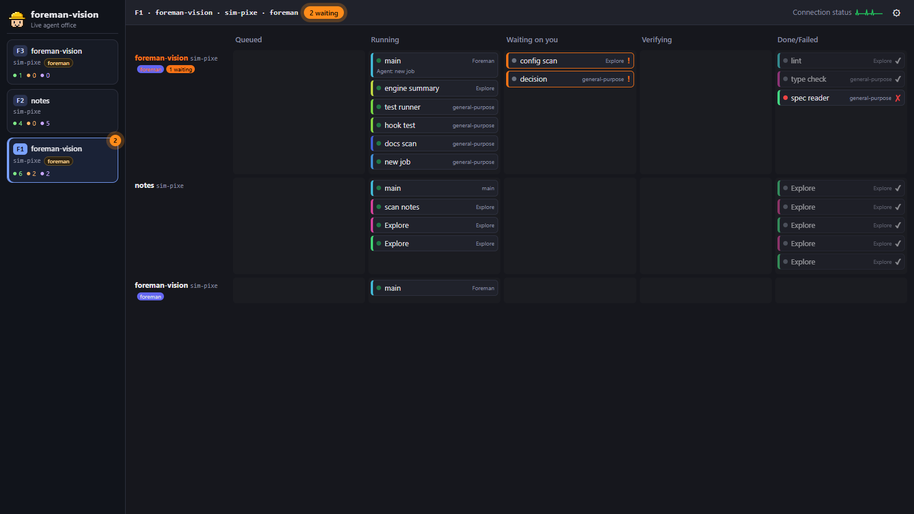
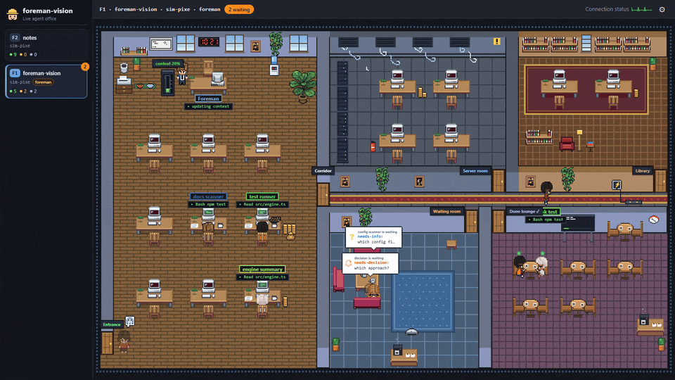
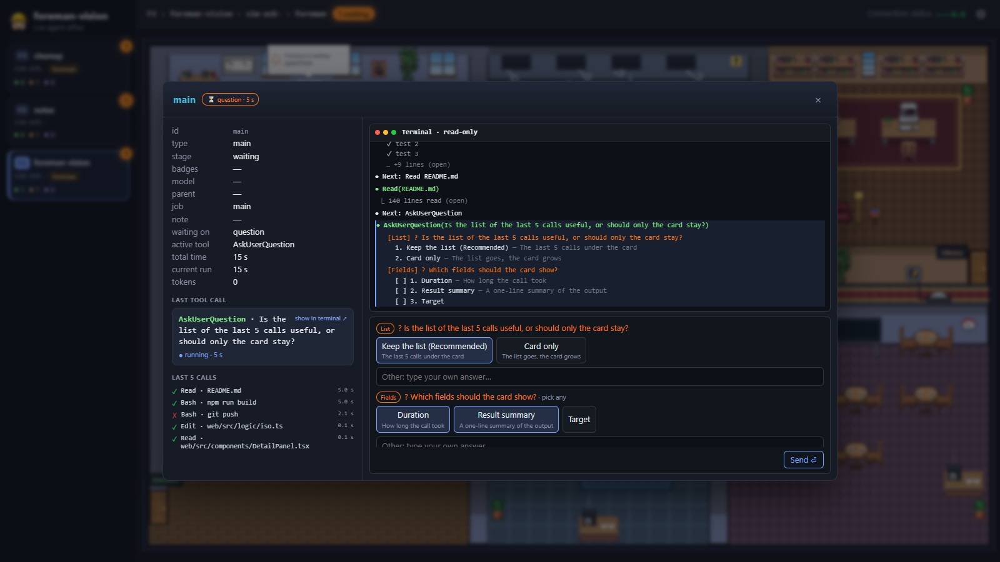

<h1 align="center">foreman-vision</h1>

<h3 align="center">A live pixel-art office for your Claude Code agents</h3>

<div align="center">


-555?style=flat)

[](LICENSE)

</div>

<div align="center">
<a href="#quick-start">Quick start</a> • <a href="#what-you-see">What you see</a> • <a href="#how-it-works">How it works</a> • <a href="#foreman-the-orchestrator-skill">foreman skill</a> • <a href="#privacy">Privacy</a> • <a href="#credits">Credits</a>
</div>

<br/>

foreman-vision turns every Claude Code session on your machine into a floor of a tiny office building. The main session sits at the foreman's desk, and each sub-agent it spawns walks in, takes a desk, and types away. When an agent needs your permission or an answer, it walks to the waiting room with a speech balloon over its head. When it finishes, it heads to the Done lounge and sits on the sofa. When it fails, the medics carry it out.

It runs in your browser on `127.0.0.1`, reads only what Claude Code already writes on your disk, and sends nothing anywhere.

> [!IMPORTANT]
> **foreman-vision works only with [Claude Code](https://docs.anthropic.com/en/docs/claude-code) (Anthropic's Claude) for now.** It is built on Claude Code's hook events and its session transcript files. Other coding agents and CLIs (Codex, Gemini CLI, Cursor, …) are not supported yet.

<p align="center">
  
</p>

<p align="center"><sub>The isometric office, driven by the built-in simulator.</sub></p>

## What you see

- **One floor per session.** Every Claude Code session on the machine gets its own floor, listed in the left sidebar (highest floor number on top) with running / waiting / done counters. Floor numbers (`F1`, `F2`, …) follow session age with no gaps: when a floor goes, the ones above it move down one; a floor's office colour stays with the session.
- **Sub-agents as pixel characters.** Each sub-agent walks to a desk in one of three work rooms (main office, server room, library) and keeps it until it is done. Its job and current tool show under its name (`▸ Bash npm test`).
- **Five rooms and a corridor.** Main office, server room, library, waiting room and the Done lounge, each with its own door, sign and theme.
- **Waiting is impossible to miss.** Permission requests, questions and foreman decisions put the agent in the waiting room with a balloon: a bell or siren when you have to act, a question mark when the foreman will handle it.
- **Three views of the same data.** Pixel office, Hybrid (the main agent in the middle, stage cards orbiting around it) and Kanban (Queued · Running · Waiting on you · Verifying · Done/Failed, one lane per session).
- **Two office styles.** Flat top-down or true isometric pixel art. Switching styles never makes anyone walk again.
- **Isometric zoom.** `−` / `+` / Reset next to the floor title work like your browser's Ctrl− / Ctrl+ on the isometric office alone: each step (1× to 3×) lays the office out anew at that pixel size, so it fills its area with fewer, bigger tiles on `+` and more, smaller ones on `−` (agents may change desks). Past the smallest office the steps magnify it and it scrolls. Your last zoom is remembered across reloads. With no zoom stored the isometric office fills its area (on a 1920×1080 screen 1.25×); Reset returns there. Flat ignores the zoom.
- **The Done lounge.** Finished agents stay for at most ten minutes, then burn to ash and leave the smart board (the CLI board keeps the real counts). Agents sitting opposite each other at a café table chat in little clouds; at night the smart board glows, throwing a V of light on the floor and flickering now and then.
- **The foreman corner.** A context gauge next to the foreman's desk fills green, amber, then red as the main session's context window fills up; the foreman walks over to update it.
- **Office life.** Windows follow your local time (clouds, birds, stars at night), the office dims in the evening and desk lamps come on, along with the foreman's desk lamp, a floor lamp by the waiting-room sofas and the library reading lamp. Smooth the cat wanders between rooms and naps on busy desks (click her for hearts), and every few minutes walks to her food and water bowls in the main office for a bite and a drink; a cleaning robot does its round every ten minutes.
- **Couriers.** When the main agent calls a Microsoft 365 or Google connector tool (MCP), a courier with a matching cap brings an envelope to the foreman's desk.
- **Coins and flames.** Busy sub-agents stack gold coins by their tokens (the context the CLI shows for them) and collect them on payday; an agent running for more than ten minutes gets a flame on its monitor.
- **Agent details with a live terminal.** Click any agent for a pop-up with its details, its last tool call (status, time, a one-line result) and its last five calls on the left, and its terminal on the right. The terminal collapses tool results like the CLI: a click opens one, and an Edit opens as a red/green diff. In a foreman session, when the main agent asks you something (AskUserQuestion), you can answer it from the main agent's pop-up: the terminal's own dialog stays open until one of them answers. Nothing else is ever sent to an agent.
- **Notifications.** Tab title count, favicon dot, desktop notifications and an optional sound. Clicking a notification jumps to the agent's floor and opens it.
- **English and Turkish UI.** Pick the language in settings.
- **Respects `prefers-reduced-motion`.** Decorative motion stops; status markers stay.

<table>
  <tr>
    <td></td>
    <td></td>
  </tr>
  <tr>
    <td align="center"><sub>Flat style</sub></td>
    <td align="center"><sub>Isometric style</sub></td>
  </tr>
  <tr>
    <td></td>
    <td></td>
  </tr>
  <tr>
    <td align="center"><sub>Hybrid view</sub></td>
    <td align="center"><sub>Kanban view</sub></td>
  </tr>
</table>

<p align="center">
  
  <br/><sub>The flat office with the floor sidebar.</sub>
</p>

<p align="center">
  
  <br/><sub>Agent details and the live terminal</sub>
</p>

## Requirements

- **[Claude Code](https://docs.anthropic.com/en/docs/claude-code)** installed and in use. foreman-vision has nothing to show without it.
- **Node.js 22.18 or later.** The server runs its TypeScript sources directly, with no compile step.
- **bash and [jq](https://jqlang.github.io/jq/)** in the shell Claude Code runs hooks in. On Windows that is Git Bash (shipped with Git for Windows); install jq there too.
- **curl**, for `/foreman-vision start|stop|status` and for the answer hook that lets the pop-up answer the main agent's question (curl comes with Git Bash and macOS), and **git**, only to install from a clone.
- **macOS or Windows (Git Bash).** Those are the platforms it has been used on. Linux is untested.
- A modern desktop browser.

## Quick start

Ask your agent:

```text
Install foreman-vision by following https://raw.githubusercontent.com/ilkemerol/foreman-vision-pub/main/INSTALL.md
```

[INSTALL.md](INSTALL.md) checks the tools, finds an earlier install, installs foreman-vision the way you choose and runs the checks.

There are two ways to install it by hand. Pick one: with both on one machine, both hooks run and every event is spooled twice. The browser UI is prebuilt in `web/dist`, so neither needs `npm install`.

**As a plugin (recommended).** This repo is its own plugin marketplace:

```bash
claude plugin marketplace add ilkemerol/foreman-vision-pub
claude plugin install foreman-vision@foreman-vision
```

Inside a session the same is `/plugin marketplace add ilkemerol/foreman-vision-pub` and `/plugin install foreman-vision@foreman-vision`. Then restart Claude Code, or run `/reload-plugins`. The hooks come with the plugin; there is nothing to merge into `settings.json`. Start the view with `/foreman-vision start`, which prints the URL; `/foreman-vision stop`, `status` and `url` do the rest. Update with `claude plugin update foreman-vision@foreman-vision`, then `/reload-plugins` or a restart. Third-party marketplaces do not update on their own by default; turn that on under `/plugin` > Marketplaces. [CHANGELOG.md](CHANGELOG.md) lists what each update brings.

**From a clone.** Clone it anywhere except under `~/.claude/skills/`, where Claude Code would also load it as a plugin:

```bash
git clone https://github.com/ilkemerol/foreman-vision-pub.git
cd foreman-vision-pub
node src/cli.ts install       # adds the hooks to ~/.claude/settings.json (backup first)
node src/cli.ts doctor        # checks jq, curl, the plugin, the hook entries, the answer hook and the spool folder
node src/cli.ts serve         # http://127.0.0.1:4780/
```

Open <http://127.0.0.1:4780/> and start (or restart) a Claude Code session. Its floor appears as soon as the first hook event arrives.

Restart any Claude Code session that was already running before `install`: it does not pick up hooks added while it runs.

> [!NOTE]
> `install` writes absolute paths (the hook scripts in this repo, the spool folder, the port file) into `settings.json`. If you move or rename the repo folder, or change `spool-dir`, run `node src/cli.ts install` again. The plugin needs neither: its hooks read `spool-dir` from `foreman-vision.conf` and find the port file themselves.

### Try it without Claude Code running

The simulator plays scripted sessions into a throwaway sandbox, so you can look around without touching your real data:

```bash
node src/cli.ts simulate --scenario pixel --port 4787
# other scenarios: --scenario hybrid | done | fire | ask      speed: --speed 2
```

- `pixel`: floors arrive over time; agents work, wait for a permission or an answer, finish and fail.
- `hybrid`: a large foreman floor whose stages keep moving, next to two other sessions; made for the Hybrid and Kanban views.
- `done`: one foreman floor of twelve agents that finish one after another and fill the Done lounge.
- `fire`: five sub-agents pass 30 minutes of work and the server room catches fire; the fire brigade puts it out.
- `ask`: a foreman floor's main agent asks two questions and waits; answer them from its pop-up. On two other floors the questions are answered in the terminal.

Every image on this page was recorded from the simulator.

### Uninstall

Plugin: stop the view with `/foreman-vision stop`, then

```bash
claude plugin uninstall foreman-vision@foreman-vision
claude plugin marketplace remove foreman-vision
rm -f ~/.claude/foreman-vision/plugin-root
```

Clone:

```bash
node src/cli.ts uninstall
```

This removes only foreman-vision's own hook entries from `settings.json`, after taking a backup. Other hooks are left alone. Nothing else is deleted: the `settings.json.fv-backup-<time>` files, `~/.claude/foreman-vision/` (with the spool folder, or your own `spool-dir` if you set one) and `~/.claude/foreman-vision.conf` (if you created it) stay for you to delete, along with the repo folder.

## Usage

| Command | What it does |
|---|---|
| `node src/cli.ts serve [--port N]` | Serves the UI and the live event stream on `127.0.0.1` (default port 4780). |
| `node src/cli.ts simulate [--scenario pixel\|hybrid\|done\|fire\|ask] [--speed X] [--port N]` | Runs a scripted demo in a temporary sandbox. |
| `node src/cli.ts simulate [x.jsonl ...] [--copies N] [--speed X] [--port N]` | Replays recorded hook sessions in a temporary sandbox, one floor per file and copy; with no file it replays `test/fixtures/*.jsonl`. |
| `node src/cli.ts install` | Merges the hooks into Claude Code's `settings.json`. Idempotent; writes a `settings.json.fv-backup-<time>` first and stops without writing if the file is not valid JSON. |
| `node src/cli.ts uninstall` | Removes only foreman-vision's hook entries. |
| `node src/cli.ts doctor` | Reports jq, curl, the plugin, how many hook events are registered in `settings.json`, whether the answer hook is installed (or comes with the plugin), and the spool folder; warns when the plugin and those entries are both active. |
| `/foreman-vision start\|stop\|status\|url` | Plugin only: starts or stops the server in the background, or prints its state or URL. |
| `bash bin/fv-server.sh start\|stop\|status\|url` | The same from a shell; the plugin also puts `fv-server.sh` on the Bash tool's `PATH`. |

`npm run fv -- <command>` works too.

**In the browser,** the ⚙ button opens the settings drawer: view (Pixel office, Hybrid, Kanban), office style (Flat, Isometric), context window (200k or 1M), language, sound and notifications. Settings are saved in your browser's `localStorage`. Pick a floor in the sidebar, hover an agent for its last tools, click it for the details pop-up. In the isometric office, `−` / `+` / Reset next to the floor title change the zoom.

**Server settings** live in `~/.claude/foreman-vision.conf` (one `key=value` per line). Command-line flags win over the file, the file wins over the defaults:

```ini
port=4780
# silence after which an agent counts as abandoned
abandon-minutes=10
spool-dir=/path/to/spool
```

Comments go on their own `#` line; text after a value is read as part of the value.

`CLAUDE_CONFIG_DIR` is honoured if you keep Claude Code's config somewhere other than `~/.claude`.

## How it works

```
Claude Code ──hook──► fv-hook.sh ──append──► spool/<session>.jsonl ──► local server ──SSE──► browser
                      (bash + jq)            ~/.claude/foreman-vision     (Node, 127.0.0.1)    (Vite + React,
                                                                              ▲                  Canvas 2D)
                                         transcripts, sub-agent meta files, foreman board (read only)
```

1. **Hook.** The plugin, or `install` for a clone, registers `hook/fv-hook.sh` for Claude Code's `SessionStart`, `SessionEnd`, `UserPromptSubmit`, `PreToolUse`, `PostToolUse`, `PostToolUseFailure`, `Notification`, `Stop`, `SubagentStart`, `SubagentStop` and `PermissionRequest` events. The hook trims each payload to the few fields the server reads, appends one short JSON line to `~/.claude/foreman-vision/spool/<session-id>.jsonl`, never prints anything and always exits 0. It does no networking, so no event is lost while the server is down. Both also register `hook/fv-ask.sh` for `PermissionRequest` on `AskUserQuestion` (timeout 3600 s): it hands the question to the server on 127.0.0.1 with `curl --noproxy '*'` and prints the pop-up's answer as the hook's decision, only as an allow decision rebuilt with jq; with no server or no answer it prints nothing, so the terminal decides. `serve` writes its port to `~/.claude/foreman-vision/port` for this hook and removes the file on exit.
2. **Server.** A small `node:http` server tails the spool files, links sub-agents to the calls that spawned them by their ids (no timing guesses), reads token and context use from Claude Code's transcripts, and folds everything through a pure reducer into an in-memory snapshot. There is no database and no history: restart it and it rebuilds the state from the spool.
3. **Browser.** The UI gets a full snapshot over Server-Sent Events, then throttled updates. All three views draw from the same store; the office is plain Canvas 2D with the text (names, balloons, signs) laid over it as DOM.

Finished sessions fade out and are swept a minute after their last event. Sessions whose Claude Code process died without saying goodbye are detected and closed too.

## foreman, the orchestrator skill

foreman-vision started as the window into **foreman**, a Claude Code skill that puts the main session into orchestrator mode: it only plans, splits the work, delegates each piece to a sub-agent, relays between them and verifies their results, while it keeps an agent board of every piece and its stage.

```
/foreman on               orchestrator mode on for this session
/foreman off              mode off
/foreman status           show the mode and the agent board
/foreman <task>           run one task in orchestrator mode
/foreman <skill> <args>   run a skill in orchestrator mode
```

**You do not need foreman to use foreman-vision.** Every Claude Code session shows up, with or without it. When foreman is on in a session, its floor gets more:

- the main agent becomes the **Foreman** at its own desk, and the floor card gets a `foreman` badge;
- board rows add **job names, notes and stages** that hooks alone cannot know: `queued` pieces wait by the entrance as faded placeholders, `verifying` shows while the foreman checks a result, and `done` / `failed` come from the board;
- foreman's waiting reasons (`needs-decision`, `blocked`, `needs-info`, `needs-agent`) become balloons, and the first two notify you;
- `/foreman on` offers to start foreman-vision and gives you the URL; `/foreman off` offers to stop it, or, while other foreman sessions still use it, to hide only this session's floor (the floor crumbles away).

foreman lives in its own, separate repository: **[ilkemerol/foreman](https://github.com/ilkemerol/foreman)**, with its own install steps. Like foreman-vision, it works only with Claude Code. foreman finds a clone through its hook entry in `settings.json`, and the plugin through `~/.claude/foreman-vision/plugin-root`, which the plugin writes at every session start.

## Privacy

- The server listens on `127.0.0.1` only and rejects requests whose `Host` is not `127.0.0.1` or `localhost` (DNS-rebinding guard).
- Nothing leaves your machine: no accounts, no telemetry, no external requests at runtime. Every asset is served locally.
- Hook payloads contain prompts and file paths, so the hook keeps only short, trimmed fields and writes them under your Claude config folder.
- The transcript endpoint behind the read-only terminal, the floor hide/show endpoints and the answer endpoints require a custom header that other web pages cannot send without a CORS preflight, and the server sends no CORS headers. File paths are never taken from the browser.
- The terminal is strictly read-only: foreman-vision never types into an agent. The one thing it sends is your answer to the main agent's open question in a foreman session, from its pop-up, as the answer hook's decision.
- Spool files are deleted a minute after their session ends, or after 24 hours without a change.

## Limitations

- Claude Code only (see above).
- Live view only: no history, replay or analytics.
- It cannot bring a terminal window to the front; notifications take you to the agent in the browser.

## Development

```bash
npm install
npm test            # node:test, including the web/dist check below
npm run typecheck
npm run dev         # Vite dev server for the UI; /events and /api go to the server's port
npm run build       # builds the UI into web/dist
```

`web/dist` is committed, so the plugin and a fresh clone work without npm. **Run `npm run build` before every push.** The build writes a hash of the web sources to `web/dist/sources.sha256`, and `npm test` fails while `web/dist` is older than its sources.

The empty `"overrides": {}` in `package.json` is on purpose: Claude Code skips its automatic `npm install` for a plugin that defines `overrides`, and the plugin needs no npm packages. Without it, every plugin install or update downloads the dev dependencies.

## Credits

foreman-vision stands on the shoulders of other projects.

- **[Pixel Agents](https://github.com/pixel-agents-hq/pixel-agents)** by Pablo De Lucca, MIT License. The characters, furniture, floor and wall sprites in `web/public/pixel-agents/` come from Pixel Agents (pinned at commit `d1e007a`); its license is kept next to them. Pixel Agents credits its characters to [JIK-A-4's Metro City character pack](https://jik-a-4.itch.io/metrocity-free-topdown-character-pack) (CC0). Pixel Agents was also an inspiration for reading Claude Code transcripts and drawing with plain Canvas 2D.
- **[LottieFiles](https://lottiefiles.com)** animations under the Lottie Simple License: confetti, bell, question mark, alert lamp, success check, and "Coffee cup being filled" by Carolina Salazar (`web/public/lottie/`). What each one is used for and the known authors are listed in [`web/public/lottie/README.md`](web/public/lottie/README.md).
- **[lottie-web](https://github.com/airbnb/lottie-web)** (MIT) plays them.
- **[claude-office](https://github.com/paulrobello/claude-office)** by Paul Robello and **[Claude-Code-Agent-Monitor](https://github.com/hoangsonww/Claude-Code-Agent-Monitor)** (both MIT) inspired the hook-based design, the safe settings merge, the simulator and the "silence never means done" rule.
- The isometric furniture and walls, the cat, the robot, the couriers and the rest of the office life are drawn procedurally in code.

Product names and logos shown by the couriers (Microsoft 365, Teams, Outlook, Google, Gmail, …) are trademarks of their owners. foreman-vision is not affiliated with or endorsed by them, or by Anthropic.

## License

foreman-vision's own code is released under the [MIT License](LICENSE).

**Third-party assets** keep their own licenses and are not covered by the MIT license above:

- `web/public/pixel-agents/`: from [Pixel Agents](https://github.com/pixel-agents-hq/pixel-agents), MIT License, © 2026 Pablo De Lucca ([license](web/public/pixel-agents/LICENSE)). The characters derive from JIK-A-4's Metro City pack (CC0).
- `web/public/lottie/`: LottieFiles animations under the [Lottie Simple License](web/public/lottie/LICENSE.md).
